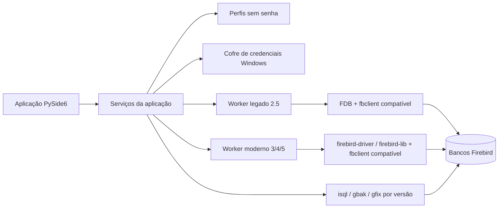

# Validação técnica e arquitetura

Data da análise: 15/10/2026. Versões solicitadas: Firebird 2.5, 3, 4 e 5. Uso local e remoto será contemplado no desenho e validado separadamente.

## Conclusão de viabilidade

Uma aplicação Windows livre de IDE paga é tecnicamente viável em Python. A interface pode ser feita com PySide6. O Firebird publica dois drivers Python: FDB para Firebird 2.x/3 e `firebird-driver` para 3+. A biblioteca `firebird-lib` acrescenta exploração de metadados e monitoramento para 3+. O suporte a 2.5 precisa de um adaptador específico e testes em ambiente real; não se deve assumir que uma mesma DLL cliente e uma mesma implementação atendem todas as versões.

O projeto usará Python 3.12 como alvo inicial. No ambiente de preparação, o FDB 2.0.4 foi importado com sucesso no Python 3.14 e foi detectada uma `fbclient.dll` 2.5. Isso valida apenas a presença dos componentes; não houve conexão com banco. Testes de importação no Python alvo, conexão, Unicode, operações de serviço e empacotamento são bloqueadores antes da primeira versão utilizável.

## Arquitetura proposta

O perfil registra nome, host, porta, caminho ou alias, versão esperada, usuário, papel, charset e caminhos das ferramentas do Firebird. A senha fica no cofre do sistema. Cada operação recebe um identificador, estado, horário, banco alvo, saída redigida e resultado.

## Matriz de recursos

| Recurso | Firebird 2.5 | Firebird 3/4/5 | Validação necessária |
|---|---|---|---|
| Conectar e consultar | FDB | `firebird-driver` | Local/remoto, charset, autenticação, TLS quando aplicável. |
| Script completo | `isql` 2.5 | `isql` da versão do servidor | `SET TERM`, erro no meio, DDL/DML e transações. |
| Backup lógico | Serviço/`gbak` compatível | Serviço/`gbak` compatível | Arquivo local ou no servidor, progresso, falha e espaço livre. |
| Restore | `gbak` compatível com destino | Serviço/`gbak` compatível com destino | Criar banco novo, teste de abertura e versão ODS. |
| Comparação de estrutura | Metadados via FDB | `firebird-lib` + catálogo | Objetos e sintaxe que diferem entre versões. |
| Saúde | `MON$`, cabeçalho e utilitários | `MON$`, `firebird-lib`, utilitários | Permissões, custo sob carga, limites por versão. |

## Regras da comparação

1. Extrair um modelo normalizado de tabelas, colunas, tipos, domínios, chaves, índices, constraints, views, procedures, triggers, sequences, exceções e privilégios. Pacotes e tipos exclusivos de versões novas só aparecem quando suportados.
2. Mostrar `somente na origem`, `somente no destino` e `definição diferente`, com DDL lado a lado e filtro por tipo.
3. Gerar migração em ordem de dependências, com verificações de versão e prévia. Mudanças ambíguas ou destrutivas (DROP, tipo menor, NOT NULL com dados existentes, alteração de dependências) exigem revisão manual; o gerador marca o que não sabe resolver.
4. A primeira versão compara **esquema**, não linhas de dados. Igualdade semântica de PSQL e permissões entre versões deve ser testada; texto diferente nem sempre significa comportamento diferente.

## Saúde do banco

Indicadores candidatos: versão/ODS, disponibilidade, tamanho, página, OIT/OAT/OST/NEXT_TRANSACTION, transações longas, conexões, consultas ativas, erros de backup, última validação e crescimento histórico. `MON$` usa uma fotografia por transação; uma coleta nova precisa encerrar a transação anterior. A coleta deve ser breve e configurável para não sobrecarregar servidores em produção.

O aplicativo deverá explicar a evidência de cada alerta, seu grau de confiança e a recomendação. Exemplo: um afastamento persistente entre OAT e NEXT_TRANSACTION pode motivar investigação de transações longas. Não transformar uma medida isolada em diagnóstico automático nem executar `gfix -mend` sem análise humana.

## Pontos ainda não comprovados

- FDB legado com Python 3.12 e o cliente Firebird 2.5 no empacotamento Windows.
- Coexistência de clientes Firebird 2.5/3/4/5 no instalador e seleção sem conflito.
- Diferenças de autenticação e permissões nas conexões remotas.
- Backup e restore remotos com arquivo no cliente versus no servidor.
- Precisão do gerador de DDL em comparações entre versões diferentes.

## Fontes

- [Drivers oficiais Python](https://firebirdsql.org/en/python-driver/)
- [FDB no Firebird](https://www.firebirdsql.org/file/documentation/drivers_documentation/python/fdb/usage-guide.html)
- [`firebird-driver` e serviços](https://firebird-driver.readthedocs.io/en/stable/usage-guide.html)
- [`firebird-lib` e esquema](https://firebird-lib.readthedocs.io/en/stable/)
- [`isql` e `SET TERM`](https://firebirdsql.org/file/documentation/html/en/firebirddocs/isql/firebird-isql.html)
- [`gbak` e migração de ODS](https://firebirdsql.org/file/documentation/html/en/firebirddocs/gbak/firebird-gbak.html)
- [Tabelas `MON$`](https://www.firebirdsql.org/file/documentation/chunk/en/refdocs/fblangref30/fblangref30-appx05-montables.html)
- [Licença do Qt for Python](https://doc.qt.io/qtforpython-6/)
